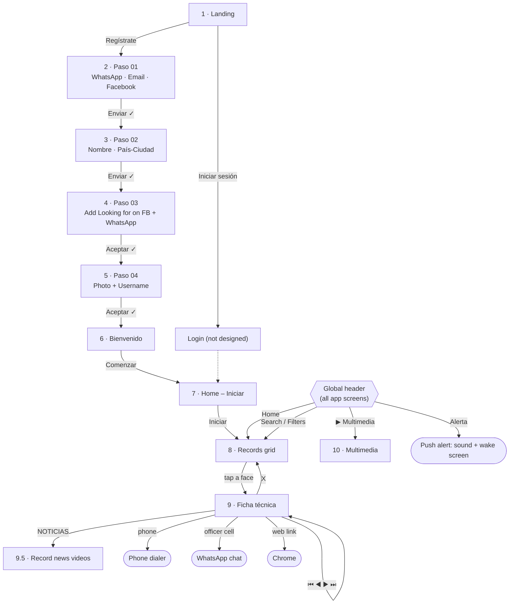

# "Looking for" – App UX Flow & Screen Guide

> **Tagline:** *"…hoy por ti, mañana por mí… En todo momento"*
> A Spanish-language Android app that recruits citizens as volunteers to help find missing people. Users register once, then browse a feed of missing-person records ("fichas técnicas") styled like police flyers, receive alerts, and watch related news videos.

---

## 1. Overview

The app has two phases:

| Phase | Screens | Purpose |
|---|---|---|
| **A. Onboarding** | 1 → 2 → 3 → 4 → 5 → 6 | Register the user and build their private **user record (Ficha Usuario)** |
| **B. Main app** | 7 → 8 ⇄ 9 → 9.5, plus 10 | Browse, filter and search **missing-person records (Fichas Técnicas)**, get alerts, watch videos |

### Navigation map

---

## 2. Onboarding (Screens 1–6)

### Shared elements on registration screens
- **Logo:** orange map pin with a white person and the wordmark "Looking **for**".
- **Green check (✓)** next to the main button turns on when that step is valid or complete.
- **Step indicator ("Paso 0X"):** four numbered nodes (01–04) joined by an orange line. **Each node darkens once its step is done**, and pending steps stay light.
- All data from steps 01–04 goes to the server and database to build the **Ficha Usuario** (one individual record per user).

---

### Screen 1 – Landing / Splash
**Purpose:** Entry point.

| Element | Function |
|---|---|
| Logo + tagline "…hoy por ti, mañana por mí…" | Brand / mission statement over a faded grid of faces |
| "En todo momento" | Sub-tagline (orange) |
| **Regístrate** (orange, filled) | Starts registration → Screen 2 |
| **Iniciar sesión** (outlined) | Log in for existing users (no screen designed yet) |

---

### Screen 2 – Registration Paso 01: Contact info
| Field / Element | Function |
|---|---|
| **WhatsApp** (phone icon) | User's WhatsApp number. Stored privately and **never displayed** |
| **E-mail** (envelope icon) | User's email |
| **Facebook** (FB icon) | User's Facebook account |
| **Enviar** + ✓ | Sends the data to the database, the check turns on → Screen 3 |
| Paso 01 indicator | Node 01 active |

---

### Screen 3 – Registration Paso 02: Name & location
| Field / Element | Function |
|---|---|
| Map + pin illustration | Visual cue for location |
| **Nombre** (user icon) | User's name |
| **País – Ciudad** (pin icon) | Country and city |
| **Enviar** + ✓ | Saves the data → Screen 4 |
| Paso 02 indicator | Nodes 01–02 dark, 03–04 light |

---

### Screen 4 – Registration Paso 03: Social link
**Purpose:** The user agrees to add "Looking for" to their WhatsApp and Facebook contacts so they can receive and share search information.

| Element | Function |
|---|---|
| **Facebook "click"** | Sends or opens a **friend request** with the Looking for Facebook account |
| **WhatsApp "click"** | Opens a WhatsApp chat with the Looking for number, with the message *"Agrega este número para poder compartir información y actualizaciones del servicio de ayuda que realizamos"* |
| Consent text | "¿Aceptas añadir en tus contactos de WhatsApp y Facebook a Looking for para poder ayudar en nuestro servicio de búsquedas?" |
| **Aceptar** + ✓ | **Disabled until both links are done.** Then the check turns green and the button becomes enabled → Screen 5 |
| Paso 03 indicator | Nodes 01–03 dark |

---

### Screen 5 – Registration Paso 04: Profile
| Element | Function |
|---|---|
| **Avatar circle** | The user **takes a photo with the camera**. It is attached to their Ficha Usuario and is **not publicly visible** |
| **Usuario** field | The user creates a **username tied to their phone number**. The phone number is **never shown** |
| **Aceptar** + ✓ | Completes registration → Screen 6 |
| Paso 04 indicator | All four nodes dark |

---

### Screen 6 – Welcome
| Element | Function |
|---|---|
| "¡Bienvenido!" | Confirmation |
| "Gracias por brindarnos tu ayuda." | Thank-you message |
| **Comenzar** | Opens the main app → Screen 7 |

---

### Resulting data: Ficha Usuario (user record)
| Field | Source | Visibility |
|---|---|---|
| WhatsApp number | Paso 01 | Private (identity key, never shown) |
| E-mail | Paso 01 | Private |
| Facebook | Paso 01 | Private |
| Nombre | Paso 02 | Private |
| País – Ciudad | Paso 02 | Private |
| Facebook / WhatsApp linked | Paso 03 | Internal |
| Fotografía | Paso 04 | **Not visible**, stored on the record only |
| Usuario (username) | Paso 04 | Public handle |

---

## 3. Main App (Screens 7–10)

### Global header (on every app screen)

| Element | Function |
|---|---|
| **▶ Multimedia** (orange play icon) | Opens the Multimedia section → Screen 10 |
| **(●) Alerta** (red pin with waves) | Alert system. Must **activate even when the app is closed**, **play a sound and turn the screen on** |
| **Home** (logo) | Returns to the main grid (Screen 8). **Must be present on every screen after onboarding** |
| **Search bar 🔍 (Buscador)** | Searches the records database by **any field** of a record. Results show in **chronological order** |

### Filter buttons (Screens 7, 8, 9, 9.5)

| Row | Type | Buttons | Maps to record field |
|---|---|---|---|
| Row 1 | **Tipo 1 – general categories** | Adulto Mayor · Adultos · Adolescentes · Niños | Record category / title (e.g. "ADOLESCENTE DESAPARECIDA") |
| Row 2 | **Tipo 2 – specific attributes** | Fecha · Edad · Ciudad · Género · Zona | Fecha → report/disappearance dates · Edad → EDAD · Ciudad → CIUDAD · Género → SEXO · Zona → ZONA |

### "Pantalla" (content area)
The header and filters are a **fixed frame**. Only the area below them (the "pantalla") changes, switching between the **grid (8)**, the **record (9)** and the **record news (9.5)**.

### Phone navigation bar
The Android system bar (recents / home / back) must work normally, especially **Back**.

---

### Screen 7 – Home: start state
| Element | Function |
|---|---|
| Blurred collage of faces | Background |
| **Iniciar** (big orange button) | Opens the **missing-person records table** and the rest of the tools → Screen 8 |

---

### Screen 8 – Records grid (main screen)
| Element | Function |
|---|---|
| **4-column grid of face photos** | Each photo is one **Ficha Técnica**. Tapping it opens that record → Screen 9 |
| **Chronological order** | Newest records first |
| **Date separators** | Section headings by **day and month**, in folder order |
| **Scroll** | Up and down, loading more records until the last one |
| Filters / Search | Narrow down the grid |

---

### Screen 9 – Ficha Técnica (missing-person record)
A police-style flyer shown in the content area, below the header and filters.

**Display rule:**
- **Bold / black labels** are fixed template text. They never move or change.
- **Regular-weight values** are variables from the records table in the database.

| Section | Contents |
|---|---|
| **Title** | Depends on category, e.g. "ADOLESCENTE DESAPARECIDA", plus a record NÚMERO |
| **Photo** | Person's photo from the records database |
| **NOTICIAS button** | Opens this record's news videos → Screen 9.5 |
| **Exit icon / ✖ (red X)** | Closes the record → back to Screen 8 |
| **Case data** | F N, HRS, R-No, Hora del, Libro, Fojas |
| **Personal data** | Fecha de nacimiento, Nombre, C.I., Edad, Sexo, Zona, Señas particulares, Ciudad, Tipo de vestimenta |
| **Disappearance** | Desapareció (date), Hora, Circunstancias (free-text description) |
| **"AYÚDANOS A ENCONTRAR"** | Call to action |
| **Phone numbers** (PAC, Radio Patrulla, División de Trata y Tráfico) | **Tap to call** (open the dialer) |
| **Officer's cell (Celular)** | Opens a **WhatsApp chat** |
| **Web links** (felcc.go.bo, felcc.policia.bo) | Open the page in **Chrome** |
| Legal notice, rank (Teniente 1ro), Fecha del reporte | Footer info |
| **⏮ ⏭** buttons | Jump to the **first / last** record |
| **◀ ▶** buttons | Go to the **previous / next** record |

---

### Screen 9.5 – Record news (Noticias)
| Element | Function |
|---|---|
| Video list (thumbnail, duration, title, source, date) | News and videos **associated with this specific record** |
| Data source | Each record has an attached **"bloc de notas" (notepad)** where video links about that person are added |
| Header + filters | Still visible |

---

### Screen 10 – Multimedia
| Element | Function |
|---|---|
| Video list (same layout as 9.5) | General videos added **by link** that relate to the app's subject (how to search for people, government reports, DNA databases, etc.). **Not tied to any record** |
| Header | Top bar only, **no filter rows** |
| Access | ▶ Multimedia button in the header |

---

## 4. Data model summary

| Entity | Fields |
|---|---|
| **Ficha Usuario** | whatsapp, email, facebook, nombre, país, ciudad, fotografía (private), usuario, fb/wa linked |
| **Ficha Técnica** | categoría, número, foto, F N, HRS, R-No, hora del, libro, fojas, fecha de nacimiento, nombre, C.I., edad, sexo, zona, señas particulares, ciudad, tipo de vestimenta, desapareció (fecha/hora), circunstancias, oficial (rango, celular), fecha del reporte |
| **Noticias (per record)** | ficha_id, video URL, title, source, date, thumbnail |
| **Multimedia (general)** | video URL, title, source, date, thumbnail |

---

## 5. Open points to define

1. **Login ("Iniciar sesión")** has no screen yet. Phone number plus a one-time code would fit, since the phone number is the user's identity.
2. **Paso 03:** Facebook and WhatsApp APIs can't send friend requests or confirm that someone added a contact. Options are following a Facebook Page or WhatsApp Channel, or a `wa.me` click-to-chat link, with the step made optional or completed on tap.
3. **Alerta:** decide what triggers an alert and who receives it (everyone, by city, or by GPS), and what tapping the Alerta button does.
4. **Admin side:** decide who creates, approves and updates records, adds video links and sends alerts.
5. **Case status:** add "found" / closed so resolved cases (especially minors) are removed or marked quickly.
6. **Privacy:** protect minors' data (photo, C.I.), get consent for the user photo, and enforce the hidden phone number on the server side.
7. **Contact data:** verify the hotline numbers (e.g. "PAC 120") and the two FELCC website addresses.
8. **Copy fixes:**

   | Current | Correct |
   |---|---|
   | Registrate | Regístrate |
   | iniciar Sesion | Iniciar sesión |
   | Adolecentes | Adolescentes |
   | Genero | Género |
   | Pais | País |
   | mañana por mi | mañana por mí |
   | Forjas | Fojas |
   | busquedas | búsquedas |
